
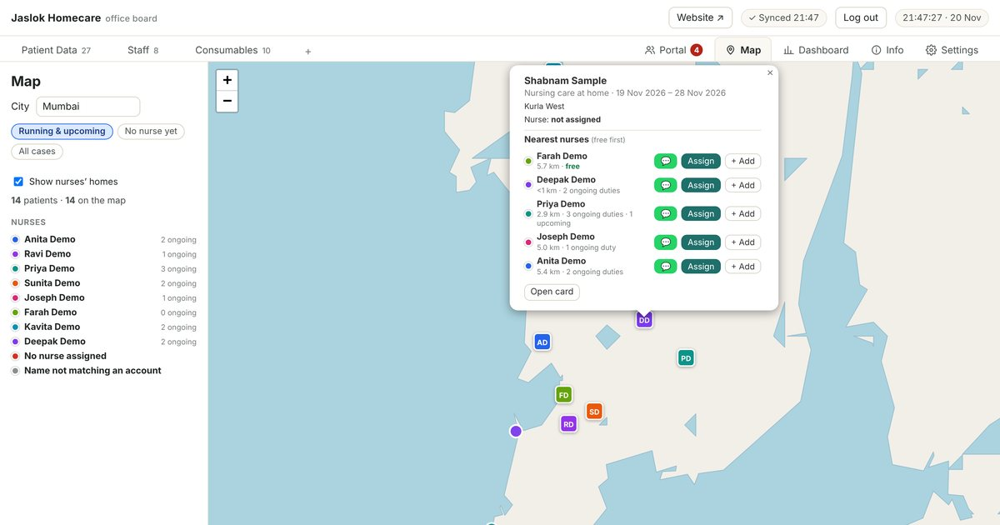

<h1 align="center">Jaslok@Home Care Platform</h1>

<b>A hospital information system (HMIS), rebuilt for care delivered at home.</b> 
Patient registration · map-based nurse rostering · billing · staff ledger · patient &amp; nurse apps · WhatsApp · MIS dashboard

<a href="https://aaryan-25.github.io/Jaslok-Home/about.html"><b>📖 About &amp; one-minute video</b></a> &nbsp;·&nbsp;
<a href="https://aaryan-25.github.io/Jaslok-Home/"><b>🌐 Website</b></a> &nbsp;·&nbsp;
<a href="https://aaryan-25.github.io/Jaslok-Home/admin.html?demo=admin"><b>▶ Live demo (office)</b></a> &nbsp;·&nbsp;
<a href="https://aaryan-25.github.io/Jaslok-Home/portal.html?demo=patient">Patient app</a> &nbsp;·&nbsp;
<a href="https://aaryan-25.github.io/Jaslok-Home/portal.html?demo=staff">Nurse app</a>

## ▶ One-minute walkthrough

<a href="https://aaryan-25.github.io/Jaslok-Home/media/walkthrough.mp4">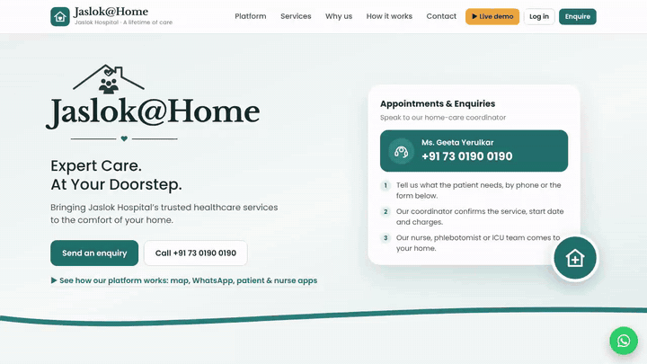</a> Silent preview plays above · <a href="https://aaryan-25.github.io/Jaslok-Home/media/walkthrough.mp4"><b>Watch the full-quality video</b></a> · <a href="https://aaryan-25.github.io/Jaslok-Home/about.html">About page</a> · All data in the demo is fictional.

## Why it exists
Home-care services usually run on phone calls, WhatsApp chats and separate Excel sheets. A hospital has an HMIS; a home-care service rarely does, even though it needs the same things (registration, scheduling, billing, HR and feedback) across a "ward" spread over a whole city. Jaslok@Home puts all of it on **one record per case**, with a separate simple app for the office, the nurse and the family.

## HMIS modules, adapted for home care
| HMIS module | In Jaslok@Home |
|---|---|
| Front office / enquiries (CRM) | Website enquiry form with prescription upload, "Request this nurse", an enquiry inbox, and one-click conversion to a case |
| Patient registration (UHID) | Families register with their mobile number; all their cases link automatically |
| Episode of care (like ADT) | Case cards with a clear life-cycle: Enquiry → Active → Recovered / Sent home / Closed |
| Rostering & allocation | **Live map** of patients and nurses, with the nearest *free* nurse suggested and assignment in one click |
| Nursing notes & handover | Handover notes, patient updates and alerts with photos, shared with the next nurse |
| Billing & receivables | Days × rate billing, payment status, balances, WhatsApp payment reminders |
| HR & payroll inputs | A **staff ledger** that fills itself: days worked, earnings, paid and pending payouts, duty history |
| Medical records / documents | Bills, care plans and reports per case, each with who-can-see-it control |
| Patient portal & communication | Patient app, two-way messages, notices, **WhatsApp templates** |
| Feedback & grievance | Nurse profiles (reached by a QR code) with verified patient reviews, and moderation by the office |
| MIS & reports | One-page performance dashboard, plus Excel import/export of every sheet |
| Inventory | Consumables and equipment-rental sheet |

## Screens
| | |
|---|---|
| 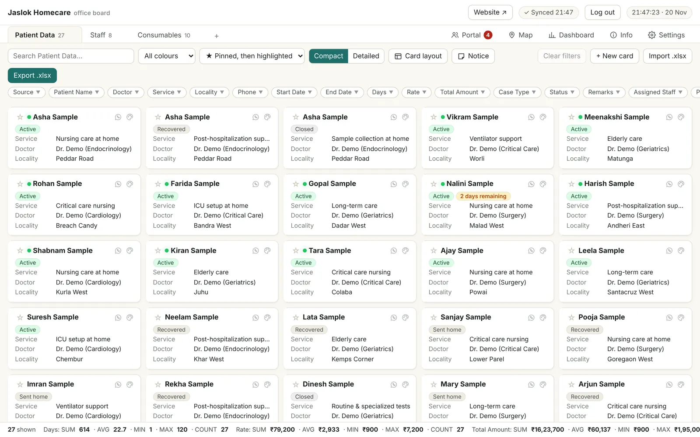 <b>Office board</b>: the patient spreadsheet as cards | 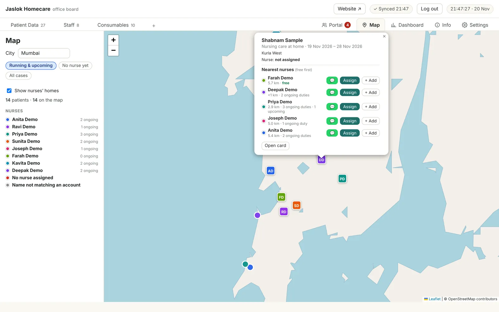 <b>Map</b>: the nearest free nurse in one click |
| 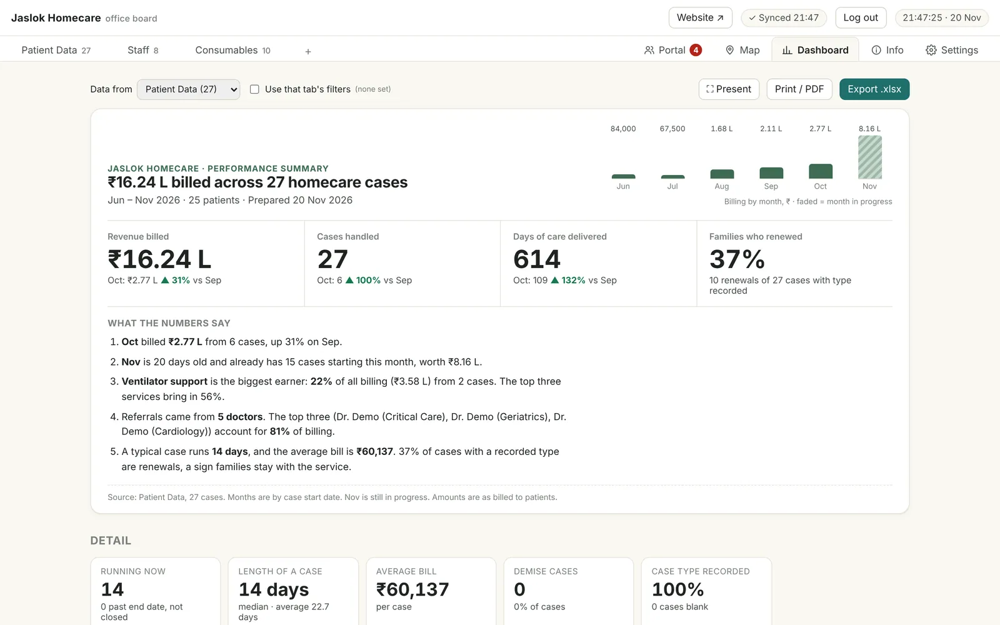 <b>MIS dashboard</b> in plain sentences | 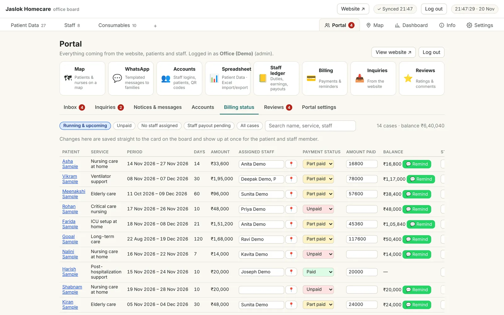 <b>Billing</b>: payments, balances, payouts |
| 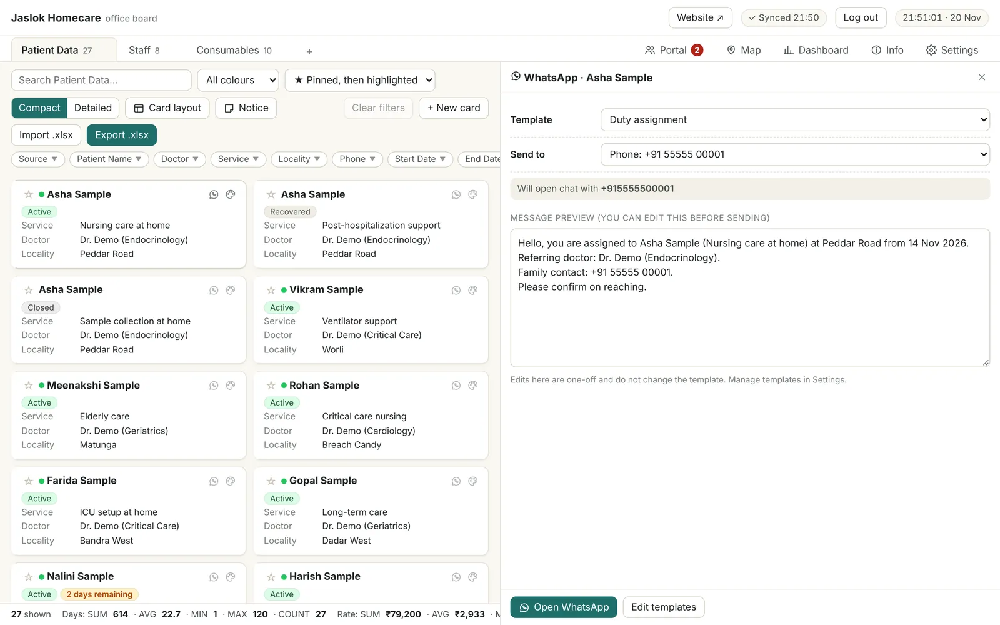 <b>WhatsApp</b> templates filled in from the case | 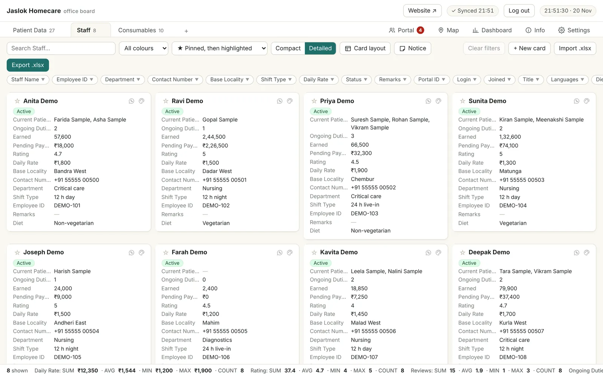 <b>Staff ledger</b> that updates itself |

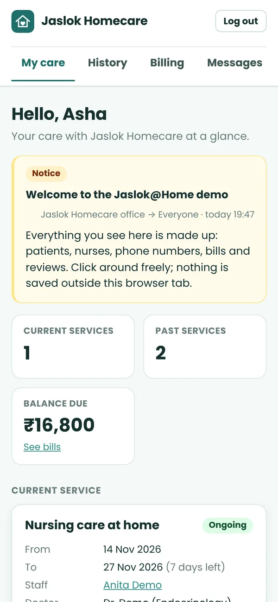 &nbsp; 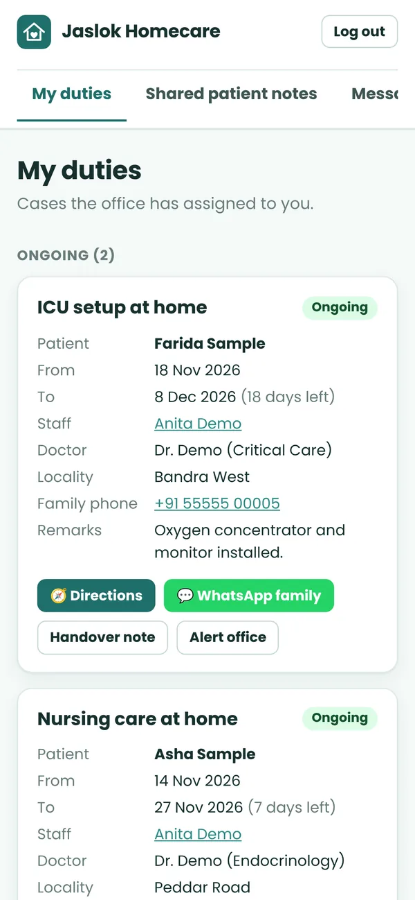 &nbsp; 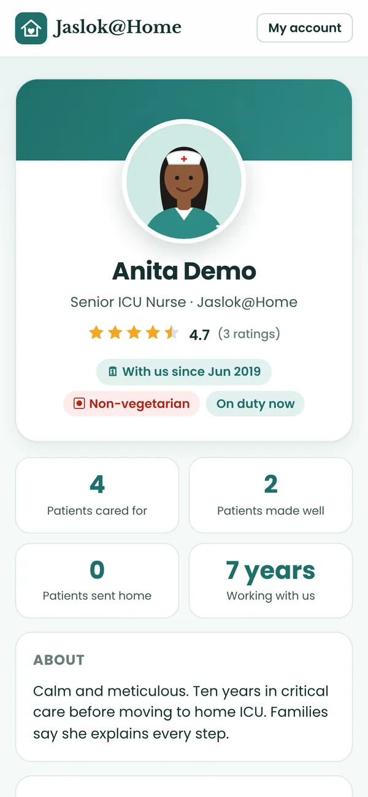 Patient app · Nurse app · Public nurse profile (opened by the QR code on her business card)

## Privacy by design
Access rules are enforced **inside the database**, not just hidden on screen. Families see only their own cases, never internal remarks or what the nurse is paid. Nurses see only their assigned patients. One admin account manages everything. Passwords are stored hashed, with lock-out after repeated wrong attempts, and every case keeps an activity log. The public demo runs on fictional data in the visitor's browser and never touches real records.

## Built with
A browser app that installs on phones (PWA) · Supabase (PostgreSQL) with row-level security and checked database functions · Leaflet with OpenStreetMap / Ola Maps · WhatsApp click-to-chat links · hosted on GitHub Pages. No licence fees.

**Designed & built by Aaryan Ahuja**, Master of Hospital Administration, Tata Institute of Social Sciences (TISS), Mumbai.

---

<b>For administrators: setup and technical notes</b>

| Page | Who | What |
|---|---|---|
| `index.html` | Everyone | Public website: services, how it works, inquiry form, login, patient sign-up |
| `portal.html` | Patients, staff | Patient: current service, history, bills, messages (query / feedback / report staff). Staff: duties, shared patient notes, handover/alert/query to office, billing & income |
| `admin.html` | Admin (one account) | The original card board + new **Portal** tab: inbox, inquiries, notices & messages, accounts, billing status, portal settings |

## First run
1. Open `admin.html`. It asks you to create the single admin account (login ID `admin`).
2. Portal → Accounts → create staff logins (Staff ID + temporary password; they must change it on first login). Use the same name you type in **Assigned Staff** on a case.
3. Patients sign up on the website with their mobile number. Cards whose **Phone** matches appear in their account automatically.
4. Edit the contact details at the top of the `<script>` in `index.html` (`SITE.phone`, `whatsapp`, `email`, `address`, `hours`). Blank ones are hidden.

## How the data connects
- Cases live on the board (Patient Data tab). Four tags were added, hidden from the card face: **Assigned Staff**, **Payment Status**, **Amount Paid**, **Staff Payout**.
- Patient ↔ case: phone number match, or linked by hand in Portal → Accounts.
- Staff ↔ case: their name (or Staff ID) in Assigned Staff. Several staff: separate with commas.
- Staff income = days worked so far × their daily rate (set in Accounts).
- Handover notes go to the office; **Share with staff on this case** makes them visible to every staff member assigned to that patient.

## Online database (Supabase) — one-time setup
1. Supabase dashboard → your project → **SQL Editor** → **New query**.
2. Open `supabase/setup.sql`, copy everything, paste, press **Run**. You should see "Success. No rows returned".
3. Open `admin.html` on the website and create the admin account. Done.

The connection details are in `js/config.js` (project URL, publishable key, Ola Maps key).

How it is protected:
- The website never reads tables directly. All tables have row-level security with no policies, so the public key cannot touch them. Everything goes through the functions in `setup.sql`, which check the login token first.
- Passwords are stored as bcrypt hashes. 8 wrong passwords lock an account for 10 minutes. Patient/staff logins last 30 days, admin 12 hours.
- A patient only receives their own cases, and never the Remarks, Staff Payout, cost or margin columns. A staff member only receives cases assigned to them (patient bill and family phone can be hidden in Portal settings).
- The website inquiry form is limited to 5 per phone number per day.

The board is saved on this device and in the database (header shows "✓ Synced"). Opening `admin.html` on another computer loads the latest board. Avoid editing the board on two computers at the same time: the last save wins.

**Updating:** whenever a new version of `setup.sql` arrives, run it again in the SQL Editor. It keeps all existing data (version 3 added document storage, version 4 adds nurse profiles and reviews).

## Live demo (fictional data)
The website's **Explore the platform** section opens a demo of every feature with made-up patients, nurses, bills, reviews and map locations. It runs entirely in the visitor's browser tab (`js/demo.js`): it never touches the Supabase database and disappears when the tab is closed. Links: `admin.html?demo=admin`, `portal.html?demo=patient`, `portal.html?demo=staff`, `?demo=reset`, `?demo=off`. Demo password: `demo1234`.

## Features at a glance
- **Map tab** (office board): patients coloured by nurse, red = no nurse; nurses' homes; click a patient for the nearest free nurse and assign in one click. Uses the Locality on the card + the City setting; Ola Maps looks each place up once and remembers it.
- **Documents**: attach files to a case (choose who sees it: office / patient / staff / both), to messages and replies, and to website inquiries. Max 5 MB each; photos are shrunk automatically. Stored in the database (free plan ≈ 500 MB).
- **Directions** for nurses on each duty (opens Google Maps).
- **Nurse profiles & QR codes**: every staff login gets a public profile (`nurse.html?n=…`) and a QR code for their business card (Portal → Accounts → Profile & QR, with a printable 85×55 mm card). Patients (logged in) rate and review; the office can hide or delete reviews (Portal → Reviews). Visitors can “Request this nurse”.
- **Staff ledger**: the board's Staff tab fills and updates itself from staff accounts, profiles, reviews and Patient Data (duties, days, earnings, payouts, duty history).
- **Install app** button on the website, the portal and the board. The installed app opens straight into the logged-in account.

## Rules
- Never commit patient spreadsheets to the repository; GitHub Pages is public. The keys in `js/config.js` are meant to be public, but restrict the Ola Maps key to your site address in the Ola console.
- After changing any file, raise `VERSION` in `service-worker.js` so installed copies update.

